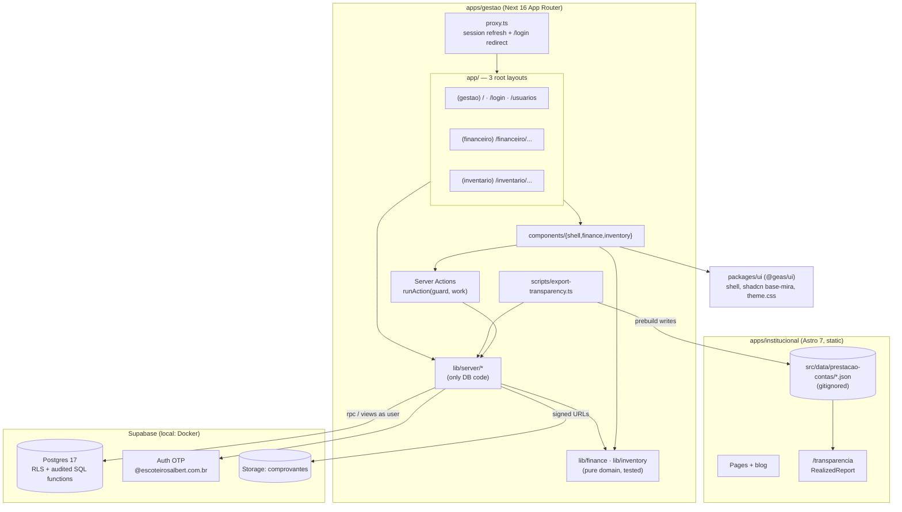
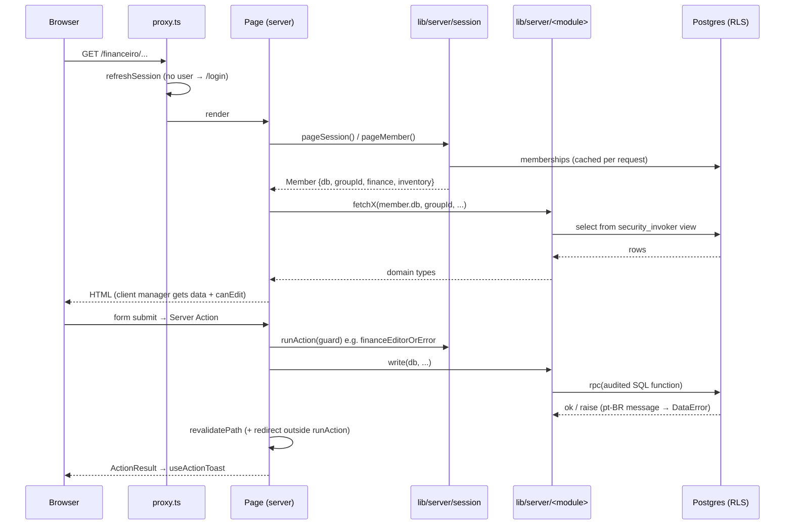

# Codebase Map

> Auto-generated by Cartographer. Last mapped: 2026-11-19T03:31:45Z.
> `total_tokens` is an estimate (bytes / 4 over tracked text files, excluding `package-lock.json` and `database.types.ts`).
> `CLAUDE.md` holds the rules; this file is the navigation layer. When they disagree, check the code.

## System Overview



## Directory Structure

```
.
├── package.json              npm workspaces apps/* packages/*; dev runs gestao + site via concurrently
├── CLAUDE.md                 rules for agents (source of truth for conventions)
├── CONTRIBUTING.md           commits, PR, rulesets, required checks
├── README.md                 STALE: still lists apps/financeiro, apps/inventario, dev:financeiro
├── commitlint.config.mjs     scopes gestao|financeiro|inventario|ui|institucional|db|e2e|deps
├── .husky/commit-msg         runs commitlint
├── .github/workflows/        ci.yml (checks, db-e2e), commits.yml (commitlint)
├── docs/
│   ├── CODEBASE_MAP.md       this file
│   ├── consolidacao-gestao.md   merge plan for financeiro+inventario → gestao (done; header still says "não iniciado")
│   └── migracao-saida-supabase.md  plan to leave Supabase (evaluation only)
├── packages/ui/              @geas/ui — shared shell + primitives, TS source, no build
│   └── src/{shell.tsx, shell.css, theme.css, components/*, lib/*}
├── apps/inventario/          DEAD: only a tracked next-env.d.ts left over (safe to git rm)
├── apps/institucional/       public site
│   ├── astro.config.mjs      integrations, aliases, sitemap filter
│   ├── DESIGN.md             palette/fonts (says "Astro 6"; package is astro ^7.4.8)
│   ├── public/               _headers (best effort), documents/*.pdf, images/
│   └── src/
│       ├── config.yaml       site/blog/store/analytics config → virtual module astrowind:config
│       ├── integration/      the astrowind integration (CLAUDE.md calls it vendor/ — no such folder)
│       ├── navigation.js     header/footer menus
│       ├── content.config.ts collections post, store, volunteers, testimonials
│       ├── content/post/     ~30 posts YYYY-MM-DD-slug.md(x)
│       ├── data/prestacao-contas/  generated JSONs (gitignored)
│       ├── layouts/          Layout, PageLayout (+ unused Landing/Markdown)
│       ├── pages/            routes (see Module Guide)
│       ├── components/       blog/ common/ ui/ widgets/ store/
│       └── utils/            blog.ts, financial-reports.ts, permalinks, images, frontmatter.mjs
└── apps/gestao/
    ├── proxy.ts              Next 16 proxy (ex-middleware)
    ├── next.config.ts        legacy redirects, globalNotFound, security headers
    ├── eslint.config.mjs     bans @supabase/* outside lib/server, e2e, scripts
    ├── app/                  routes (see Route table)
    ├── components/           shell/, finance/, inventory/
    ├── lib/                  shared root files + finance/ + inventory/ + server/
    ├── scripts/              export-transparency.ts, write-local-env.mjs, inventory/*.mjs
    ├── supabase/             config.toml, migrations 001–039, tests/, templates/magic_link.html
    ├── e2e/                  Playwright specs + support/
    ├── docs/                 modelo.md, contabilidade.md, mensalidades.md, importacao-conciliacao.md,
    │                         inventario/, associados/ (draft, not built)
    ├── BACKLOG.md            dated rounds; uses some pre-consolidation paths
    └── AGENTS.md             Next-generated: read node_modules/next/dist/docs/ before coding
```

## Module Guide

### packages/ui (`@geas/ui`)

**Purpose**: one visual identity for every internal screen. Consumed as TS source.
**Exports map**: `"."` → `src/shell.tsx`; `"./components/*"` → `src/components/*.tsx`; `"./lib/*"` → `src/lib/*.ts`; `"./theme.css"`.

| File | Purpose |
|------|---------|
| `src/shell.tsx` | `AppBrand` (module switcher, plain `<a>` to force full reload), `AppLogin`, `AppLoginForm` (OTP), `AppHeader` (nav menu below 1024px), `UserMenu`, `PageHeader` (prepends Início crumb), `PageBody`, `SectionTabs` |
| `src/theme.css` | layer order `theme, base, legacy, components, utilities`; tokens; `--app` accent per `html[data-app]` (purple; inventario = dark orange); `surface` and `num` utilities; legacy global `table {min-width:720px}` |
| `src/shell.css` | `.geas-*` classes for brand, header, login, breadcrumbs |
| `components/option-controls.tsx` | `OptionSelect`, `OptionCombobox` — string value, `""` = unset, **no `name`**: forms add a hidden input |
| `components/tree-drag.tsx` | `useTreeDrag({dropError, onDrop})`, `DragHandle`, `DROP_CLASS`; HTML5 DnD only (no touch) |
| `components/section-card.tsx`, `stat-card.tsx` | `SectionCard/Header/Body/Count`, `StatCard`, `ListCard` |
| `components/users-manager.tsx` | whole `/usuarios` screen (actions injected) |
| `lib/use-action-toast.ts` | `ActionResult {error?, success?, tone?}` → sonner toast |
| `lib/roles.ts` | email domain check, `GROUP_ROLES`, `INVENTORY_ROLES`, labels |
| other `components/*` | shadcn base-mira on **Base UI** (use `render={...}`, never `asChild`) |

### apps/gestao — routes and layouts

No `app/layout.tsx`. Three root layouts, each `RootHtml module=...` (`components/shell/root-layout.tsx`) setting `<html data-app>`. Crossing modules = full page load. Unknown URLs → `app/global-not-found.tsx`. Only `/inventario/**` has an `error.tsx`.

`fin` = `app/(financeiro)/financeiro`, `inv` = `app/(inventario)/inventario`, `gst` = `app/(gestao)`.

| URL | File | Guard | Notes |
|-----|------|-------|-------|
| `/` | `gst/page.tsx` | `pageSession` (no group → `SetupNeeded`) | Início: attention list + module cards (`finance/home`, `inventory/overview`) |
| `/login`, `/auth/confirm` | `gst/login/*`, `gst/auth/confirm/route.ts` | public | OTP code; links land on `/auth/confirm` |
| `/usuarios` | `gst/usuarios/*` | `notFound()` unless admin | actions `runAction(adminOrError)` |
| `/financeiro` | `fin/page.tsx` | `pageSession` | Resumo |
| `/financeiro/lancamentos/{movimentacoes,detalhamento}` | shared `fin/lancamentos/entries-screen.tsx` | `pageSession` | infinite list (`loadEntryPage`) |
| `/financeiro/lancamentos/realizado` | `…/realizado/page.tsx` | `pageSession` | category × month |
| `/financeiro/lancamentos/novo`, `/[id]` | `…/context.ts` `loadEntryContext` | `pageMember`; `notFound()` for non-editors on novo | `?linha=` prefill from OFX line; `?voltar=` back link |
| `/financeiro/lancamentos/[id]/anexos/[anexoId]` | route.ts | `memberOrError` | 303 to signed URL |
| `/financeiro/extrato/{conciliar,importar}` | `fin/extrato/*` | `pageSession` | reconciliation board; OFX import |
| `/financeiro/mensalidades/{controle,devedores}` | `fin/mensalidades/*` | `pageSession` | fee grid; debts |
| `/financeiro/configuracoes/[aba]` | contas, rubricas, formas, perfis, mensalidades | `pageMember`, `notFound()` if not editor | |
| `/financeiro/configuracoes/associados` | static sibling of `[aba]` | `pageMember` | only settings tab for viewers |
| `/financeiro/exportar/{fluxo,realizado,contabil,transparencia}` | route.ts | `exportContext()` = any member | XLSX/CSV/JSON; contábil 422 without `ledger_code` |
| `/inventario` | `inv/page.tsx` | `pageSession` | Resumo |
| `/inventario/materiais` (+ `/novo`, `/[id]`, `/[id]/editar`) | `inv/materiais/*` | `pageSession`; non-editors **redirected** (not 404) | tabs per root division |
| `/inventario/movimentacoes` | `inv/movimentacoes/page.tsx` | `pageSession` | `?revisao=`, `?tipo=` |
| `/inventario/configuracoes/{divisoes,familias}` | `inv/configuracoes/*` | actions `inventoryManagerOrError` | drag-ordered tree |

Redirects: area roots → first tab; `next.config.ts` 308s `/(lancamentos|extrato|mensalidades|configuracoes|exportar)/*` → `/financeiro/...` keeping the query.

**Action files**: `app/actions.ts` (entries, `withMember`, guard `memberOrError` — authorization lives in SQL), `fin/lancamentos/actions.ts` (attachments), `fin/configuracoes/actions.ts`, `fin/configuracoes/associados/actions.ts`, `fin/extrato/{conciliar,importar}/actions.ts`, `fin/mensalidades/actions.ts`, `inv/materiais/actions.ts`, `inv/configuracoes/{divisoes,familias}/actions.ts`, `gst/{login,usuarios}/actions.ts`.

### apps/gestao — components

**Pattern**: server page loads data + `canEdit`/`canManage`, passes to a `"use client"` manager that imports colocated actions.

| Area | Key files |
|------|-----------|
| shell | `shell/root-layout.tsx` (`RootHtml`, `baseMetadata`), `shell/gestao-header.tsx`, `shell/finance/app-header.tsx`, `shell/inventory/app-header.tsx`, `shell/setup-needed.tsx` |
| finance nav | `finance/nav/page-header.tsx` (`PageHeader` + "Financeiro" crumb, `EntryViewTabs`, `ExtratoTabs`, `FeeTabs`, `SettingsTabs`, `settingsCrumbs`, `NARROW_CONTENT`), `nav/year-select.tsx` |
| entries | `entries/entry-filters.tsx`, `filter-options.tsx` (`useListParams`), `multi-filter.tsx`, `infinite-entries.tsx`, `entry-editor.tsx` (`EntryListProvider`: optimistic overrides, selection keyed by `returnHref`), `entry-tables.tsx`, `entry-form.tsx`, `entry-attachments.tsx`, `bulk-account-bar.tsx`, `category-picker.tsx` |
| reconciliation / import | `reconciliation/reconciliation-board.tsx` (batched bulk create), `import/statement-importer.tsx` (client-side OFX parse, preview, profiles) |
| settings | `accounts-manager.tsx`, `catalog-manager.tsx`, `categories-manager.tsx` (Rubricas: client draft, one `saveCategoryTree`), `ledger-code-input.tsx`, `export/export-menu.tsx`, `realized/realized-table.tsx` |
| fees / debts | `fees/fee-grid.tsx` (`useOptimistic` per cell), `fees/fee-cell.tsx`, `fees/fee-settings-form.tsx`, `debts/debts-manager.tsx` |
| associates | `new-associate.tsx`, `sections-manager.tsx`, `associates-import.tsx` |
| inventory | `locations/locations-manager.tsx` (drag writes immediately, `useOptimistic`), `families/families-manager.tsx`, `materials/{material-form,fields,action-dialog,lots-table,units-table,material-filters,review-notice}.tsx`, `settings-tabs.tsx`, `table-head.ts` |

### apps/gestao — lib

| Path | Purpose |
|------|---------|
| `lib/money.ts` | `parseMoneyToCents` ("1.234,56", "R$", sign; `allowNegative`) |
| `lib/format.ts` | `money(reais)`, `formatCents(cents)`, `centsToInput`, `dateBR` (UTC noon), `shortOfxId` |
| `lib/auth.ts` | roles re-export, `canManageEntries`, `inventoryRoleOf` |
| `lib/action.ts` | `InputError`, `runAction(guard, work)` |
| `lib/finance/entries.ts`, `entry-rows.ts`, `entry-schema.ts`, `entry-history.ts`, `filters.ts` | list paths/queries (`listHref` blocks open redirect), `PAGE_SIZE=100`, zod entry schema, audit → history, URL filters (`de=tudo`) |
| `lib/finance/categories.ts`, `category-draft.ts` | code ordering, compact selection encoding; immutable Rubricas draft (`MAX_DEPTH=4`, `draftPayload`) |
| `lib/finance/accounts.ts`, `ledger-code.ts`, `catalogs.ts` | account form, default-account logic, "A definir"; mask `0.0.0.0.0000` |
| `lib/finance/associates.ts`, `associates-import.ts`, `csv-reader.ts` | branch/section/patrol placement; CSV import plan; generic CSV reader |
| `lib/finance/fees.ts`, `debts.ts`, `dashboard.ts` | fee due dates (BR holidays), cell states, suggestions; debt allocation; Resumo math |
| `lib/finance/reconciliation.ts` | exact / near (±3 days) suggestions, `closingCheck`, `reconciliationHref` |
| `lib/finance/statement-import/` | OFX reader (SGML + XML), profiles, `decodeBytes`, fixtures `itau.ofx`, `nubank.ofx` |
| `lib/finance/import-flow.ts`, `import-schema.ts` | import screen rules; server zod + `fromRpc*` converters |
| `lib/finance/attachments.ts` | bucket `comprovantes`, 10 MB, path `<group>/<entry>/<uuid>.<ext>` |
| `lib/finance/export/` | `columns.ts`, `csv.ts` (CP1252 encoder), `accounting.ts`, `period.ts`, `realized.ts`, `xlsx.ts` (ExcelJS), `route-helpers.ts`, `transparency.ts` |
| `lib/inventory/vocabulary.ts`, `model.ts`, `locations.ts` | enums + labels, `TAG_PATTERN`; types only; `treeOrder`, `placeError`, `placeLocal` |
| `lib/server/db.ts` | opaque `Db`, `DataError` |
| `lib/server/supabase/` | `db.ts` (`sb`, `untyped`, `rpc`, `unwrap`, `rowsOf`), `client.ts`, `service.ts` (`serviceDb`), `paged.ts` (`fetchPaged`, 1000/page), `proxy.ts`, `env.ts`, `database.types.ts` (generated) |
| `lib/server/session.ts` | `Member`, `getSession` (React `cache`), all guards; only reader of `memberships` |
| `lib/server/auth.ts`, `files.ts`, `users.ts` | OTP/link/sign-out; signed URLs; invite/roles/remove (service client) |
| `lib/server/finance/*.ts` | `registry`, `associates`, `entries`, `attachments`, `reconciliation`, `statements`, `fees`, `debts`, `reports`, `home` |
| `lib/server/inventory/*.ts` | `locations`, `families`, `materials`, `movements`, `overview` (typed `sb()`) |

### apps/gestao — database (`supabase/`)

**Config**: project id `geas-financeiro` (container `supabase_db_geas-financeiro`), Postgres 17, `enable_signup=false`, email OTP 6 digits, `before_user_created` hook `restrict_auth_domain`. API `max_rows` 1000.

**Migration timeline (key ones)**

| # | What |
|---|------|
| 001 | groups, memberships, categories, entries, splits, `is_group_member`, `can_edit_group` |
| 003 | one group per user, `audit_events`, admin RPCs, `admin_bootstrap_group` (postgres only) |
| 004 | payment methods, associates (**wiped entries**) |
| 006 | entry `name`, view `ledger_entry_rows` |
| 008–009 | category tree + kind; mixed-sign splits allowed |
| 011 | accounts, "A definir"/"Caixa" |
| 012–015 | statement import, reconciliation, accounting `ledger_code` (drops direct-write policies), import scenarios |
| 018–022, 029 | fees, prices, exemptions, associate movements |
| 023–026 | entry history, bulk move account, `account_balance_before`, profile admin |
| 027 | attachments + storage policies |
| 028, 030 | sections and patrols |
| 031→032 | inventory (031 dropped by 032), `memberships.inventory_role` |
| 033–035, 037 | stock by location, location order/drag (`inventory_place_location`), counts |
| 036 | category editing: `renumber_categories`, `save_category_tree` |
| 038–039 | debts and allocations, `pay_debts` |

**Views** (all `security_invoker`): `ledger_entry_rows`, `entry_split_rows`, `reconciliation_link_rows`, `fee_split_candidates`, `associate_rows`, `inventory_location_paths` (`sort_key int[]`), `inventory_material_rows`, `inventory_stock_by_location`. `debt_rows(group)` is a definer **function** so it can hide debtor identity from viewers.

**RLS**: reads `is_group_member`; no direct write policies except `associates`. Writes = security-definer RPCs that also insert `audit_events` (`{before, after}` snapshots). Inventory: `inventory_role_of` (admin → manager), `can_manage_inventory` (manager), `can_edit_inventory` (manager|chief); chief movements born `pendente`.

**Tests** (`supabase/tests/`, each in a rolled-back transaction): pgTAP `audit`, `rls_roles`, `rls_direct_writes`, `rls_isolation`, `sections`, `inventory` + fixture `_fixture.psql` (groups A/B, admin/treasurer/viewer); legacy plain `do $$` files for balances, accounting, categories, debts, entries, attachments, fees, import, reconciliation.

### apps/institucional

**Purpose**: public static site (pt-BR), customized AstroWind, Tailwind v4.
**Entry**: `astro.config.mjs` + `src/integration/index.mjs` (virtual module `astrowind:config` from `src/config.yaml`; writes `robots.txt` on build).

| Route | File |
|-------|------|
| `/` | `pages/index.astro` (Organization JSON-LD) |
| `/escotismo`, `/ciclo-programa`, `/adultos`, `/adultos/funcoes` | `pages/*.astro` |
| `/transparencia` | `pages/transparencia.astro` → `widgets/RealizedReport.astro` |
| `/blog`, `/blog/<slug>`, `/category/*`, `/tag/*` | `pages/[...blog]/*` via `utils/blog.ts` |
| `/store*` | `pages/[...store]/*` — disabled (`apps.store.isEnabled: false`) |

Collections: `post` (glob md/mdx), `store`, `volunteers`, `testimonials` (JSON `file()` loaders). Aliases `~`, `@components`, `@layouts`. GA via Partytown. Theme `light:only`.

### Root tooling and CI

- Scripts: see `CLAUDE.md` Commands. `test:db`/`db:types` use `npm exec --package=supabase` because `npx supabase` fails inside a workspace.
- CI `ci.yml`: job "Lint, types, unit tests, build" (`TRANSPARENCY_SKIP=1`) and "SQL tests (pgTAP) and e2e (Playwright)" (Supabase CLI 3.1.0, slim `supabase start -x ...`). `commits.yml`: "Commit messages". These job names are required checks.
- `.prettierrc.cjs` is the Astro site's style (single quotes); gestao code uses double quotes and has no format script.

## Data Flow

### Authenticated request + Server Action



### Attachments

Client → `prepareAttachmentUpload` (signed upload URL, path `<group>/<entry>/<uuid>.<ext>`) → direct PUT to Storage → `registerAttachment` → `add_entry_attachment` (reads size/type from `storage.objects`). Download: route → 303 to 60-second signed URL.

### OFX import → reconciliation

Browser reads the file (`decodeBytes` → `readOfx` → `applyOfxProfile`) → `previewStatementImport` (`preview_statement_lines`: new / imported / suspect / orphan) → `importStatementLines` (`import_statement_lines`, dedup by fingerprint) → `/financeiro/extrato/conciliar` board (exact / near suggestions in `lib/finance/reconciliation.ts`) → `link_reconciliation` (1:1, 1:N, N:1; never N:M).

### Transparency export → public site

`npm run build --workspace=@geas/institucional` → `prebuild` → `apps/gestao/scripts/export-transparency.ts` (reads `apps/gestao/.env.local`, `serviceDb()`) → `buildTransparencyReport(fetchRealizedModel(...))` per year → `apps/institucional/src/data/prestacao-contas/<year>.json` → validated by `src/utils/financial-reports.ts` (invalid file breaks the build) → `RealizedReport.astro`. Fails the build without DB; `TRANSPARENCY_SKIP=1` skips; local Supabase URL is refused unless `TRANSPARENCY_ALLOW_LOCAL=1`. Then manual FTP upload of `dist/`.

## Conventions

- Money: integer cents everywhere; `money()` takes reais, `formatCents()` takes cents. Dates: `YYYY-MM-DD` strings; "today" is São Paulo.
- Data access only via `lib/server/<module>` with `member.db`; data modules don't import `next/*`; validation, `revalidatePath`, `redirect` stay in the action.
- New queries use typed `sb(db)` and `rpc()`; finance code moved as-is uses `untyped(db)`.
- Writes only through audited SQL functions; changing a function signature means drop + create, then `npm run db:types --workspace=@geas/gestao`.
- Forms: visible `<Label htmlFor>`; IDs namespaced per entity (`account-${id}-name`); `OptionSelect` needs a hidden input; dialogs keyed by entity id.
- Toasts: `useActionState` + `useActionToast`; when the component unmounts on success (dialogs, removed rows), toast inside the action wrapper.
- Filters live in the query string; lists reset via `key`.
- Tree ordering only by dragging (`useTreeDrag`): Rubricas = client draft + one save; Divisões = write per drop.
- UI/comment language pt-BR; commits and CLAUDE.md in English.

## Gotchas

**Stale / leftover**
- `apps/inventario/next-env.d.ts` is tracked but the app is gone (moved in `36d4bbe`).
- Root `README.md` names `apps/financeiro`, `dev:financeiro`, `dev:inventario`.
- `CLAUDE.md` says Astro 6 and `vendor/`; reality is `astro ^7.4.8` and `src/integration/`. `DESIGN.md` also says Astro 6.
- `docs/consolidacao-gestao.md` header says "não iniciado" (it's done). `BACKLOG.md`, `docs/contabilidade.md`, `docs/inventario/BACKLOG.md` and SQL test headers use pre-consolidation paths (`/lancamentos`, `apps/financeiro`, `lib/session.ts`).
- `apps/institucional/src/utils/financial-reports.ts` comment points at `apps/gestao/lib/export/transparency.ts` (real: `lib/finance/export/transparency.ts`).
- `AnnouncementBanner` in `Layout.astro` has `expireDate="2026-08-08"` (expired); `/transparencia` stats are hard-coded ("atualizados em 05.10.2026").
- `apps/gestao/docs/associados/` and the "Ações" module are drafts; no code exists. Adding a module means a new `GestaoModule`, `AppBrand.current`, theme accent, session role.
- Untracked `default.profraw` files (LLVM) sit in several folders; `*.profraw` is gitignored.

**Database**
- Category `code` is derived by `renumber_categories` from `parent_id` + `position`; it changes on reorder. Reference by id.
- `update_ledger_entry` deletes and re-inserts splits → split ids change. `fee_record_splits.split_id` is `on delete cascade`, so **editing an entry drops its fee links**. Debts link to the entry instead.
- Deleting an entry or changing its total/account dissolves its reconciliation link set (`ledger_entry_reconciliation_guard`).
- Views can only append columns with `create or replace`; reordering requires drop + recreate (014, 017).
- Migrations 004 and 032 were destructive (dev data only).
- `debt_rows` nulls associate data for non-editors; never add client joins that reveal debtors.
- PostgREST silently truncates `.limit()` above 1000; use `fetchPaged` with a total order.
- Mirrors to keep in sync with SQL: ledger-code mask (014 ↔ `lib/finance/ledger-code.ts`), `placeError` (037), attachment bucket/path (027), transparency JSON (`lib/finance/export/transparency.ts` ↔ `apps/institucional/src/utils/financial-reports.ts`), `fromRpc*` shapes.

**App**
- `createEntry`/`updateEntry`/`deleteEntry` guard only `memberOrError`; the SQL function enforces the role. Export routes allow any member.
- Unauthorized: finance/users use `notFound()`, inventory uses `redirect`.
- `redirect()` must be called after `runAction` returns (`saveMaterial`); `runAction` rethrows non-domain errors.
- `revalidatePath("/", "layout")` after any finance write.
- Action return shapes are not unified (`Result`, `FeeResult`, `ReconciliationResult`, `ActionResult`); some files hand-roll `runAction`.
- `lib/server` imports types from `components/` and `app/` (e.g. `statements.ts` ← `extrato/importar/actions` `ImportProfile`).
- `fetchDebts`, `board()`, `fetchEntryPage` return `{error}` instead of throwing; `reports.ts` throws.
- `inviteUser` is not atomic past the membership insert; `removeUser` bans first, unbans on RPC failure.
- `CategoriesManager` initialises `draft` once from props; unsaved edits only guarded by `beforeunload`.
- `InfiniteEntries` must be re-keyed on query/view/order changes.
- `@geas/ui` root (`shell.tsx`) is a server module; Base UI → `render={}`, not `asChild`; raw `<table>` gets the legacy 720px min-width.
- Next 16: `proxy.ts` replaces middleware; `params`/`searchParams` are Promises; `experimental.globalNotFound`.

**Tests / tooling**
- E2E needs Docker (`docker exec` psql), local Supabase and Mailpit; `workers:1`, shared E2E group, port 3210 by default.
- `npx supabase` doesn't work inside a workspace; use `npm exec --package=supabase -- supabase ...`.
- No unit tests for `lib/server` or `lib/inventory`; DB covered by pgTAP, flows by e2e.
- `scripts/inventory/importar-planilha.mjs` **wipes** the group's inventory (refuses non-local URLs). CSVs are group data: never commit.

## Navigation Guide

**Add a finance screen**: page under `app/(financeiro)/financeiro/<area>/<tab>/page.tsx` using `PageHeader` from `components/finance/nav/page-header.tsx` with `crumbs`; data function in `lib/server/finance/<x>.ts`; client manager in `components/finance/`; area root redirects to first tab.

**Add an inventory screen**: `app/(inventario)/inventario/...`, data in `lib/server/inventory/`, components in `components/inventory/`, types in `lib/inventory/model.ts`.

**Add a write operation**: new migration `apps/gestao/supabase/migrations/0NN_*.sql` with a security-definer function that checks role + inserts `audit_events`; pgTAP in `supabase/tests/`; `npm run db:types --workspace=@geas/gestao`; wrapper in `lib/server/<module>/` via `rpc()`; action using `runAction(guard, ...)` + `revalidatePath`; add the table to `rls_direct_writes.test.sql` if new.

**Add a shared UI component**: `npx shadcn@latest add <name>` inside `packages/ui`, or a file in `packages/ui/src/components/`; import as `@geas/ui/components/<name>`.

**Change roles/permissions**: `lib/server/session.ts` (guards), `lib/auth.ts`, `packages/ui/src/lib/roles.ts`, SQL helpers (`can_edit_group`, `inventory_role_of`), `lib/server/users.ts`, `packages/ui/src/components/users-manager.tsx`.

**Change auth**: `lib/server/auth.ts`, `lib/server/supabase/proxy.ts`, `app/(gestao)/login/`, `supabase/config.toml` + `templates/magic_link.html`.

**Change exports**: `lib/finance/export/*` + routes in `app/(financeiro)/financeiro/exportar/*/route.ts`; accounting rules in `apps/gestao/docs/contabilidade.md`.

**Change the transparency format**: bump `version` in `lib/finance/export/transparency.ts`, update `apps/institucional/src/utils/financial-reports.ts` schema and `widgets/RealizedReport.astro`.

**Add a blog post**: `apps/institucional/src/content/post/YYYY-MM-DD-slug.md`, images in `src/assets/images/blog/<year>/`.

**Change site menus/config**: `apps/institucional/src/navigation.js`, `src/config.yaml`.
